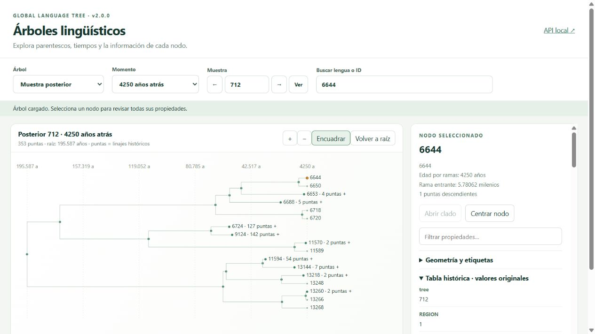

# Visualizador de árboles lingüísticos

Aplicación local para explorar el **MCC**, las **1000 muestras posteriores** y sus
cortes publicados de **3500, 4250 y 5000 años**: 4001 árboles en total. Es independiente
del GP: cambiar el árbol visible no modifica la covarianza del modelo.

## Abrir

Desde la raíz del proyecto:

```powershell
uv sync --locked --extra viewer
uv run gaussian-processes prepare
uv run --extra viewer python -m tree_viewer.prepare
uv run --extra viewer python -m tree_viewer
```

Abre **http://127.0.0.1:8769** y deja esa terminal abierta. Ctrl+C detiene el servidor.
Puedes elegir otro puerto con `--port 8770`. Si los datos ya están preparados, basta
el último comando.

La descarga inicial ocupa aproximadamente 550 MB, requiere internet y se verifica
por SHA-256. Después funciona sin conexión. Los siete archivos originales permanecen
comprimidos en `datos/tree_viewer/`, junto al catálogo; no se extraen miles de archivos.

## Usarlo

1. Elige MCC o muestra posterior. MCC es un resumen único y desactiva el número de muestra.
2. Selecciona el momento. Solo aparecen fechas y combinaciones realmente publicadas.
3. Escribe el número y pulsa **Ver** o Enter, o usa las flechas. Al cambiar la fecha se conserva su número si existe.
4. Busca por nombre, glottocode o etiqueta local. La búsqueda abre el camino al nodo.
5. Pulsa un nodo para ver sus propiedades. Doble clic o Abrir/Cerrar clado despliega sus hijos.
6. Arrastra para desplazarte, usa la rueda o +/− para acercarte y Encuadrar para ver el conjunto.
7. Filtra las propiedades por nombre o valor; también se muestran campos desconocidos.

La URL conserva el árbol: por ejemplo `?tree=posterior-712-5000`. Entre árboles actuales
se intenta conservar la lengua o el ancestro común de sus descendientes. Si el clado
incorpora descendientes adicionales, se avisa. En cortes no se presupone equivalencia
de ID numéricos: sin correspondencia comprobada se vuelve a la raíz.

## Información disponible

- MCC: soporte, edades, intervalos HPD, ubicaciones, tasas, demás campos y comentario literal.
- Posteriores actuales: topología y ramas, glottocodes, nombres del MCC y metadatos WALS.
  Los Newick `all_tree` no contienen las anotaciones resumen del MCC; no se copian como propias.
- Cortes: árbol y las **47 columnas** de su tabla, enlazadas por muestra y fecha, no por orden.
- WALS: todas las filas asociadas a cada hoja, incluso enlaces uno a varios.

Las puntas históricas son **linajes**, no observaciones modernas. El eje convierte ramas
en milenios a años antes del presente. Las anotaciones originales se muestran separadas
sin cambiar valores. `clade_age` de las tablas fue transformado por los autores y no es
una edad literal; esas tablas también pueden incluir imputaciones de los autores.

La primera carga del MCC puede tardar decenas de segundos por su abundante metadata.
La caché mantiene tres árboles. Se envía una geometría por vez y la metadata del nodo
seleccionado; no se cargan todos los árboles en el navegador.

## Organización

| Archivo | Responsabilidad |
|---|---|
| `prepare.py` | Descarga verificada y catálogo, sin extracción masiva |
| `readers.py` | NEXUS/Newick, comentarios, CSV, unidades e identidades |
| `app.py` | API de lectura, caché y archivos web |
| `__main__.py` | Inicio del servidor local |
| `static/tree.js` | SVG, tiempo, zoom y colapsado |
| `static/app.js` | Selectores, búsqueda, contexto y propiedades |
| `static/index.html`, `styles.css` | Estructura y apariencia |

FastAPI y DendroPy son dependencias opcionales (`viewer`). El frontend usa JavaScript y
SVG nativos, sin framework ni servicios externos. Añadir un formato requiere producir
el mismo esquema de nodos; no obliga a cambiar el GP.

Pruebas: `uv run --extra viewer python -m unittest discover -s tests -v`.
[Arquitectura](architecture.md) · [Fuentes y campos](data_sources.md).


